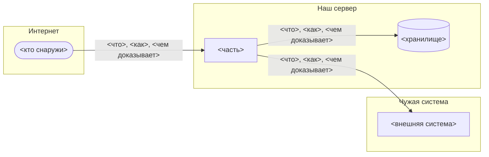

# Спецификация: <проект, подпроект или фича>

Статус: черновик | подтверждена владельцем <дата>
Владелец: <кто подтверждает и решает «не определено»>
Обновлена: <дата последней правки>
ТЗ продукта: <путь или ссылка>
Правила — `references/process/spec.md`. Проверка — `python scripts/lead/spec_check.py <этот файл>`.

## Цель и вне объёма

<Что строим, одним абзацем: кто пользуется и что получает.>

Вне объёма:
- <чего в этой версии нет и почему>

## Стек

| Что | Выбор | Версия | Почему |
|---|---|---|---|
| Язык | | | |
| Хранилище | | | |
| Тесты | | | |
| Запуск | | | |

Не использовать:
- <библиотека или приём> — <почему>

## Схема системы

<Что на схеме и чего нет. Части, которые запускаются отдельно, внешние системы и люди; модули — в карте ниже.
Стрелка — одно направление и подпись: что передаёт, как, чем вызывающий доказывает, кто он. Рамка — граница
доверия. Чего не смог подписать — в «Не определено». Правило 10 справки `spec.md`.>

## Карта модулей

Как делим папки: сверху — `docs/`, `backend/`, `frontend/`, `design/`; внутри — папка на каждую функцию продукта.
<Иначе — напиши, как, и почему.>

Корни: `<папка>/`

| Путь | Отвечает за | Вход | Может вызывать |
|---|---|---|---|
| `<папка>/<модуль>/` | <одна фраза> | `<файл>` — через него зовут модуль; «весь модуль» — любой файл | `<модуль>`, `<модуль>`; «—» — никого; «любой» |

Проверка границ: `scripts/lint/boundaries.py` по этой карте, при каждой сдаче — через `handoff/check.py`, раздел
`[boundaries]` в `kit.toml`. Ловит три вещи: модуль зовёт модуль не из своего «Может вызывать», зовёт чужой модуль
мимо входа, модули зовут друг друга по кругу.
Старые нарушения: <файл списка, например `docs/boundaries-known.json`, или «нет — проект новый»>.

## Данные

| Сущность | Где хранится | Кто меняет | Кто читает |
|---|---|---|---|
| | | | |

Миграции:
- Где лежат: <папка или файл>
- Как именуются: <номер по порядку или дата-время из генератора>
- Файл последней миграции: <`путь` — каждая новая миграция правит в нём одну строку>
- Команда создания: <`команда`>
- Выложенную миграцию не правим — исправление новой миграцией.
- Удаление колонки или таблицы — в два шага, в разных выкладках: сначала код перестаёт ими пользоваться.

## Словарь

| Термин | Что значит | В коде | На экране | У заказчика |
|---|---|---|---|---|
| | | | | |

Идентификаторы:
- <вид номера> — <откуда берётся, где можно подставлять, где нельзя>

## Интерфейсы

<Между модулями и с внешними системами: вызов, данные на входе и выходе, ошибки.>

- `<модуль>.<функция>(<аргументы>) -> <результат>` — <когда зовут>
- <внешняя система>: <запрос> → <ответ>. Образец ответа: `<путь к записи в тестах>` или «не определено: снять у …»

## Сквозные сценарии

<Два-три главных пути через модули, по шагам. Каждый шаг — модуль из карты. По ним видно, какие модули задача
задевает вместе.>

1. <сценарий одной фразой>: `<модуль>` — <что делает> → `<модуль>` — <что делает> → <что видит пользователь>

## Что менять, когда добавляешь

| Добавляешь | Меняются вместе |
|---|---|
| Настройку | |
| Маршрут | |
| Миграцию | |
| Право | |

## Сквозное

- Безопасность: <доступ, секреты, что нельзя писать в журнал>
- Журнал и наблюдение: <что пишется, где смотреть>
- Ошибки внешних систем: <что видит пользователь, что повторяется>

## Совместимость

<Что уже работает у людей и не должно сломаться: записи в базе, ссылки, внешние клиенты, настройки. Проект
новый — напиши «нет, проект новый».>

- <что> — <как не сломать: чем проверяем>

## Риски и долг

<Что может не получиться и что сознательно откладываем. Нет — напиши «нет».>

- <риск или долг> — <чем грозит> — <когда вернуться>

## Проверка

- Запуск: `<команда>`
- Тесты: `<команда>`
- Сквозная проверка готового: <что человек делает и что видит>

## Решения

Каждое решение — свой файл `<папка docs>/decisions/NNNN-название.md` по шаблону `assets/decision-template.md`.
Здесь только ссылки.

- `<docs/decisions/0001-название.md>` — <решение одной фразой>

## Не определено

- не определено: <вопрос> — решает <кто>
